# Architecture and ownership

Mode A is the default. No Azure login is needed for application tests, rendering,
scanner checks or the local Kind workflow. Mode B requires a reviewed cost sheet,
an approved bootstrap and protected Azure DevOps resources.

| Owner | Resources |
|---|---|
| bootstrap Terraform root | State RG, storage/container, platform RG, deployment identities and their scoped roles; optional Entra administrator group |
| shared-aks Terraform root | VNet/subnets/NSG, AKS, workload identities, Key Vault, optional ACR/monitoring/budget |
| cluster-services Terraform root OR Helm installer | Argo CD and its namespace; choose one owner |
| platform namespace manifests | Namespaces, quota, LimitRange, namespace RBAC |
| Argo CD application chart | Application Deployment, ClusterIP, ConfigMap, service account, NetworkPolicy, optional CSI/HPA/PDB |
| AKS service | Node RG, VMSS, disks, outbound standard load balancer and managed public IP |

Dev and Stage share a cluster to reduce lab cost. This provides namespace isolation,
not separate failure, network or administrative boundaries. No production root is
executable. Terraform does not own application releases.

## Overall workflow
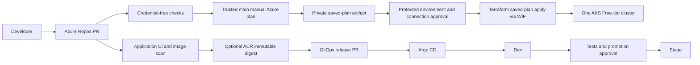

## Free account Azure layout
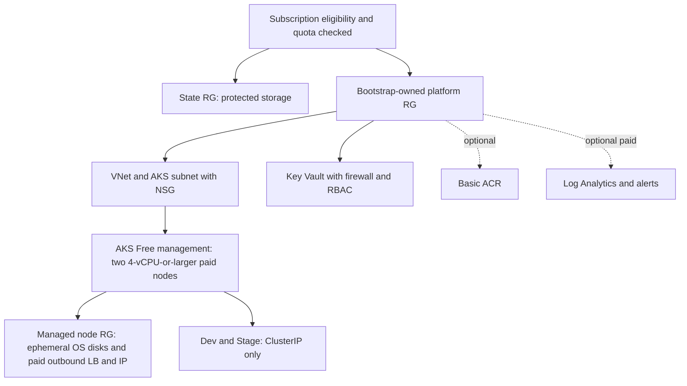

## Terraform modules
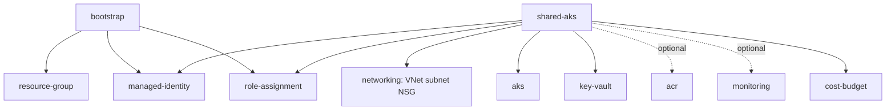

## State and locking
```mermaid
sequenceDiagram
  participant T as Terraform root
  participant E as Entra WIF
  participant B as Private Blob container
  T->>E: Request short-lived token
  E-->>T: Storage data-plane access
  T->>B: Acquire blob lease on root-specific key
  T->>B: Read state and write new version
  T->>B: Release lease
  Note over B: Versioning, soft delete, prevent_destroy; independent RG
```

## Azure DevOps identity
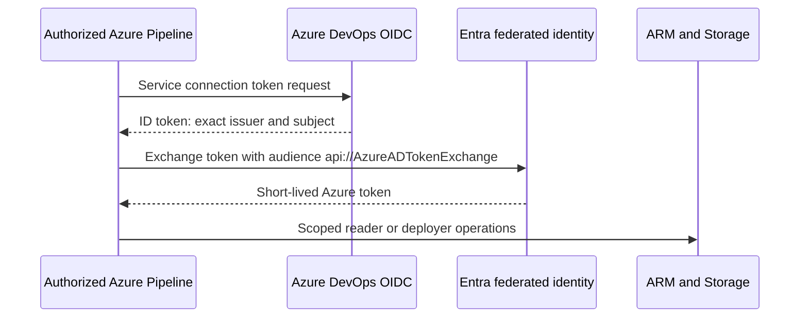

## Terraform CI/CD
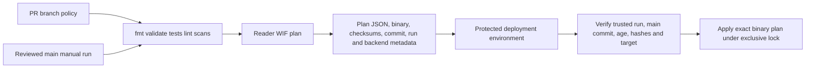

## Application delivery
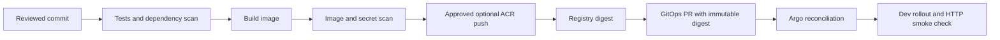

## GitOps ownership
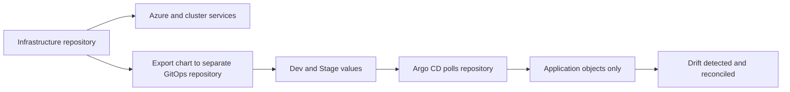

## Promotion
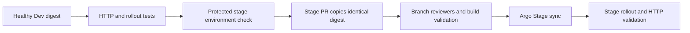

## AKS networking
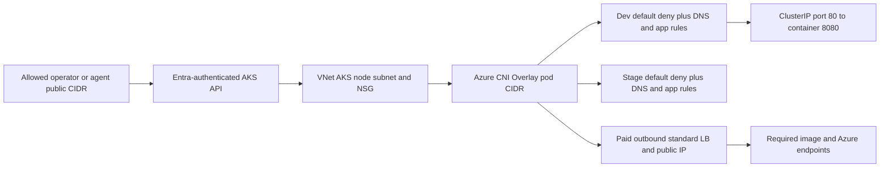

## Key Vault integration
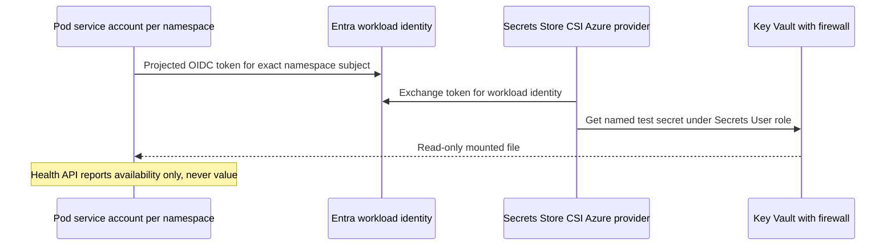

## Monitoring
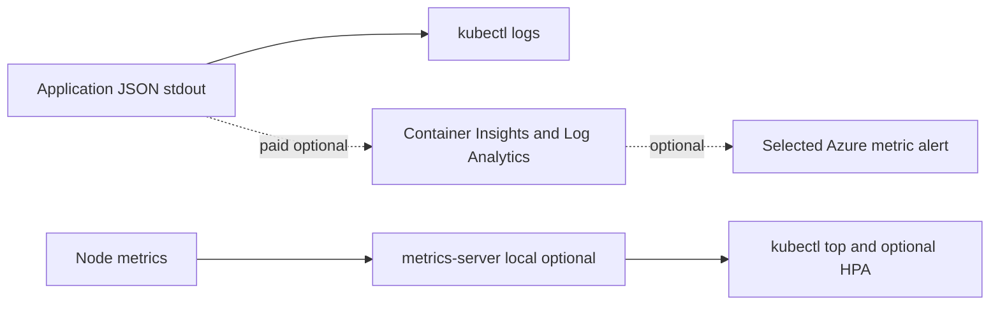

## Safe destruction
```mermaid
flowchart LR
  M[Manual target and typed confirmation] --> INV[Resource inventory]
  INV --> DP[Terraform destroy plan for shared root only]
  DP --> AR[Reviewable private artifact]
  AR --> G[Protected destroy environment and connection]
  G --> V[Provenance and expiry validation]
  V --> A[Apply exact destroy plan]
  A --> OR[Inspect platform and node RG orphans]
  OR --> B[Backend and platform RG retained by bootstrap]
```

## Modes
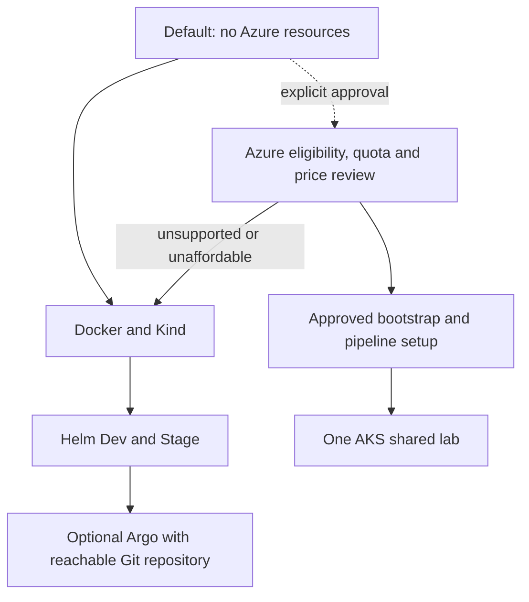
